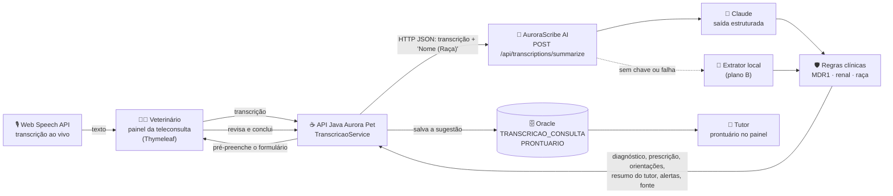
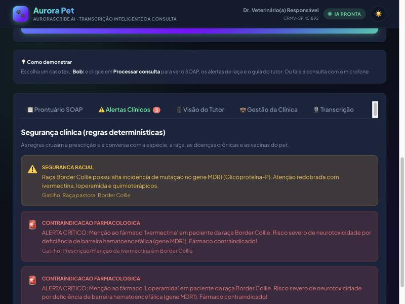
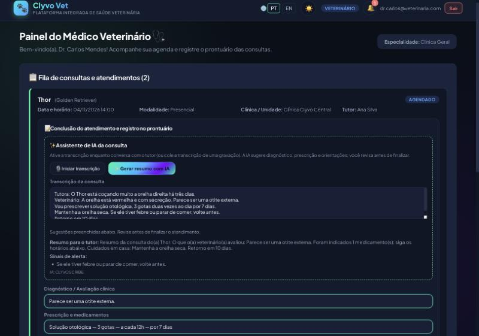

# 🐾 Aurora Pet: AuroraScribe AI

> **Transcrição inteligente da consulta veterinária.** O AuroraScribe ouve a consulta, organiza o prontuário no padrão SOAP com IA generativa, confere a prescrição com regras de segurança clínica e escreve um resumo simples para o tutor. O veterinário revisa e aprova: a IA sugere, quem decide é ele.

[](#-resultados-parciais)
[](#%EF%B8%8F-tecnologias)
[](#-abordagem-de-ia)
[](docs/DATA_DICTIONARY.md)

Disciplina: **Disruptive Architectures: IoT, IoB & Generative IA**, Challenge Aurora Pet (2TDS, 2º semestre de 2026).

| | |
|---|---|
| 🎥 **Vídeo pitch (YouTube)** | [https://youtu.be/3mCGLHQrmjg](https://youtu.be/3mCGLHQrmjg) (4 min 32 s) |
| ☕ **Aplicação Aurora Pet (API Java)** | [MCGI-PW/API-Clyvo-M_Vet](https://github.com/MCGI-PW/API-Clyvo-M_Vet) · [online](https://clyvovet-app-16666.brazilsouth.azurecontainer.io/) |
| 📄 **Documentação técnica** | [Especificação da IA](docs/AI_SPECIFICATION.md) · [Arquitetura](docs/ARCHITECTURE.md) · [Dicionário de dados](docs/DATA_DICTIONARY.md) |

## 👥 Integrantes

| Nome | RM |
|---|---|
| Maicon Douglas | RM561279 |
| Gabriel F. | RM561551 |
| Charlles | RM566482 |
| Iago D. | RM565708 |

---

## 📌 Problema

Na consulta veterinária, o profissional divide a atenção entre o animal e o teclado. O prontuário é preenchido às pressas, durante ou depois do atendimento, e fica incompleto. O tutor, ansioso, sai da clínica sem lembrar direito a dose, o horário e o que observar em casa. E um risco clínico importante, como um remédio perigoso para a raça, depende só da memória do veterinário.

## 💡 Solução e valor

| Para quem | O que o AuroraScribe entrega |
|---|---|
| **Veterinário** | Fala a consulta normalmente e recebe a **minuta do prontuário SOAP** pronta para revisar (queixa, exame, diagnóstico, prescrição com dose, frequência e duração, exames, orientações e retorno). |
| **Pet** | **Alertas de segurança** cruzando a prescrição com o perfil do animal: raças pastoras com mutação MDR1 (ivermectina, loperamida), felinos renais com anti-inflamatório, braquicefálicos, vacinas atrasadas e casos de urgência. |
| **Tutor** | **Resumo em linguagem simples**, com horários dos remédios e sinais de alerta para voltar à clínica. |
| **Clínica** | Exames e retornos citados na consulta viram **sugestões de agenda e de faturamento**. |

---

## 🧠 Abordagem de IA

Arquitetura **híbrida em três camadas**: a IA generativa entende a conversa, e regras determinísticas cuidam do que não pode errar.

| Camada | O que faz | Tecnologia | Código |
|---|---|---|---|
| **1. Fala → texto (ASR)** | Transcrição ao vivo, em português, com a frase em andamento aparecendo como legenda. Áudio gravado pode ser transcrito pelo Whisper. | Web Speech API do navegador (Chrome/Edge) · Whisper local (opcional) | `app/web/app.js` · `app/services/asr_service.py` |
| **2. Texto → SOAP (IA generativa)** | Organiza a consulta no padrão SOAP com **saída estruturada** (JSON Schema igual aos modelos de dados). O prompt proíbe inventar diagnóstico, remédio, dose ou prazo. | Claude (Anthropic), modelo `claude-opus-5-5` | `app/services/claude_extractor.py` |
| **2b. Plano B sem internet** | Sem chave de API, ou se o Claude falhar ou recusar, um extrator por regras classifica as frases reais da consulta. Nada é inventado: o que não foi dito fica vazio. | NLP por regras (Python puro) | `app/services/local_extractor.py` |
| **3. Segurança clínica (IA simbólica)** | Cruza o SOAP e a transcrição com o perfil do pet e gera alertas auditáveis, sempre iguais para a mesma entrada. | Motor de regras em Python | `app/services/decision_support.py` |
| **Saídas** | Guia do tutor (horários e sinais de alerta) e sugestões para a clínica (exames, retorno, vacinas). | Python | `app/services/tutor_care_generator.py` |

**Por que híbrida:** o LLM é ótimo para separar o que é queixa do tutor e o que é achado do exame numa conversa solta. Mas dose e contraindicação não podem depender de probabilidade, por isso a camada 3 é determinística. O plano B local garante que a consulta nunca trave por falta de internet ou de chave. Cada prontuário mostra **qual IA o gerou**: `CLAUDE:claude-opus-5-5`, `LOCAL:extracao` ou `LOCAL:protocolo-demo`.

---

## 🏛️ Arquitetura e integração com a Aurora Pet

O AuroraScribe é o **serviço de IA** da plataforma. Quem atende o usuário final é a aplicação Java (Spring Boot), que salva o resultado no **Oracle**.



1. Na teleconsulta, o veterinário liga o microfone no painel da Aurora Pet e fala a consulta (ou cola a transcrição).
2. A API Java envia a transcrição e só **nome e raça do pet** para o AuroraScribe (`AURORASCRIBE_URL`).
3. O AuroraScribe gera o SOAP (Claude ou plano B), aplica as regras clínicas e devolve o resumo.
4. A API Java grava a sugestão na tabela `TRANSCRICAO_CONSULTA` (migration Flyway `V7`) e pré-preenche diagnóstico, prescrição e orientações.
5. O veterinário revisa, corrige se preciso e conclui o atendimento: só então o texto vira prontuário, que o tutor vê no painel dele.

**Resiliência em duas camadas:** se o Claude falha, o AuroraScribe usa o extrator local; se o AuroraScribe está fora do ar, a API Java usa o assistente local dela. Em nenhum caso a consulta trava.

> **Online:** no Azure, o AuroraScribe roda no mesmo grupo de containers da Aurora Pet, e a API Java o chama em `http://localhost:8000`. Ele não é exposto na internet: quem fala com o usuário é só a aplicação Java.

Detalhes em [`docs/ARCHITECTURE.md`](docs/ARCHITECTURE.md).

---

## 🗂️ Dados utilizados

| Dado | Origem | Uso pela IA |
|---|---|---|
| Transcrição da consulta | Microfone (Web Speech API), áudio gravado (Whisper) ou texto colado | Entrada do SOAP (camada 2) |
| Espécie e raça | Cadastro do pet | Regras de raça (MDR1, braquicefálicos) e de espécie (felino renal) |
| Peso | Cadastro do pet | Cálculo de dose por kg nos protocolos de demonstração |
| Comorbidades crônicas | Prontuário do pet | Contraindicação de anti-inflamatório em felino com doença renal |
| Histórico vacinal | Cartão de vacinas | Alerta e sugestão de reforço para vacina atrasada |
| Casos de exemplo | `samples/audio_transcripts.json` · `samples/pet_profiles.json` | Demonstração e testes reprodutíveis (Thor, Mel e Bob) |

Schemas completos, contrato da API e tabela do Oracle em [`docs/DATA_DICTIONARY.md`](docs/DATA_DICTIONARY.md).

---

## 🚀 Como executar

Precisa só do **Python 3.9+**. Nenhum pacote é obrigatório.

```bash
git clone https://github.com/MCGI-PW/IoT-Clyvo-Vet_M.git
cd IoT-Clyvo-Vet_M
python3 run_server.py          # abre em http://localhost:8000
```

Abra no **Chrome ou Edge**: o microfone (Web Speech API) só funciona neles. Para mudar a porta: `python3 run_server.py 8090`.

**Com Docker** (a mesma imagem que roda no Azure):
```bash
docker build -t aurorascribe .
docker run --rm -p 8000:8000 aurorascribe
```

**Testes:**
```bash
python3 -m unittest discover -s tests -p "test_*.py"
```

**Ligar o Claude** (opcional; sem ele, o plano B local responde):
```bash
pip install anthropic
export ANTHROPIC_API_KEY="sua_chave"
python3 run_server.py
```

**Transcrever arquivo de áudio** (opcional e pesado, instala o PyTorch): `pip install openai-whisper`.

**Com FastAPI** (opcional, gera a documentação Swagger em `/docs`): `pip install -r requirements.txt` e `uvicorn app.main:app --reload`.

### Integrado com a Aurora Pet

Com o AuroraScribe rodando na porta 8000, suba a API Java apontando para ele:

```bash
cd ../API-Clyvo-M_Vet
AURORASCRIBE_URL=http://localhost:8000 ./mvnw spring-boot:run -Dspring-boot.run.profiles=local \
  -Dspring-boot.run.arguments=--server.port=8081
```

Abra `http://localhost:8081`, entre como veterinário (`dr.carlos@veterinaria.com` / `senha123`) abra o atendimento do Thor e, no **Assistente de IA da consulta**, cole ou fale a transcrição e clique em **Gerar resumo com IA**. O resumo é gravado com a fonte `AURORASCRIBE`, e quando a raça pede (ex.: Border Collie com ivermectina), os alertas clínicos aparecem nos sinais de alerta, marcados com ⚠.

---

## 🖥️ Como usar a interface de demonstração

1. **Escolha o paciente:** Thor (Buldogue Francês, otite e vacina atrasada), Mel (gata Siamês com doença renal) ou Bob (Border Collie, sensível a ivermectina).
2. **Transcrição:** clique em **Iniciar Escuta** e fale, cole uma transcrição ou carregue um caso de exemplo.
3. **Processe** e navegue pelas abas:
   - **Prontuário SOAP**: a minuta para o veterinário revisar, com a fonte da IA;
   - **Alertas Clínicos**: cards por gravidade (info, amarelo, vermelho);
   - **Visão do Tutor**: o resumo em formato de mensagem, com horários e sinais de alerta (simulação da tela do celular, nada é enviado);
   - **Gestão da Clínica**: exames, retorno e vacinas sugeridos, com valor estimado;
   - **Transcrição**: o texto integral usado.

---

## 📊 Resultados parciais

Resultados reais da execução local (sem chave do Claude), com os casos de `samples/`.

| Caso | Fonte da IA | Gravidade | Alertas gerados | Saídas |
|---|---|---|---|---|
| **Thor**, Buldogue Francês, otite | `LOCAL:protocolo-demo` | monitoramento | ℹ️ braquicefálico · 🟡 antirrábica atrasada | 1 prescrição a cada 12h por 10 dias; citologia; retorno em 10 dias; R$ 195 em itens sugeridos |
| **Mel**, gata Siamês, doença renal | `LOCAL:protocolo-demo` | **urgência** | 🔴 anti-inflamatório contraindicado em felino renal · 🔴 gravidade imediata | 2 prescrições, internação e exames renais; R$ 680 em itens sugeridos |
| **Bob**, Border Collie, claudicação | `LOCAL:protocolo-demo` | monitoramento | 🟡 raça com mutação MDR1 · 🔴 ivermectina · 🔴 loperamida | 2 prescrições, raio-x se não melhorar; R$ 190 em itens sugeridos |
| **Consulta livre** (texto falado, sem gabarito) | `LOCAL:extracao` | monitoramento | ℹ️ braquicefálico | Diagnóstico "otite externa"; prescrição "Solução otológica, 3 gotas, a cada 12h, por 7 dias"; retorno em 10 dias; sinal de alerta "febre ou parar de comer" |

A consulta livre usada:

```text
Tutora: O Thor está coçando muito a orelha direita há três dias e balança a cabeça.
Veterinário: A orelha está vermelha e com secreção. Parece ser uma otite externa.
Vou prescrever solução otológica, 3 gotas duas vezes ao dia por 7 dias.
Mantenha a orelha seca e não use cotonete. Se ele tiver febre ou parar de comer, volte antes.
Retorno em 10 dias.
```

**Evidências das telas:**

| AuroraScribe: alertas do Bob (Border Collie) | Aurora Pet: resumo gerado pelo AuroraScribe (`IA: AURORASCRIBE`) |
|---|---|
|  |  |

Na segunda tela, a API Java chamou `POST /api/transcriptions/summarize` (HTTP 200 no log do AuroraScribe), gravou a sugestão no banco e pré-preencheu diagnóstico, prescrição e orientações para o veterinário revisar.

**O que os testes garantem** (14 testes, `tests/`):
- o pipeline completo dos três casos gera os alertas esperados (MDR1, renal, vacina);
- numa consulta livre, o extrator usa **só o que foi dito**: nada dos protocolos de demonstração vaza, e sem retorno falado não há prazo inventado;
- o nome do remédio sai limpo, e frequência e duração faladas ("duas vezes ao dia", "por dia", "por sete dias", "durante duas semanas") viram números;
- a resposta estruturada do Claude vira SOAP válido, e falha ou recusa do Claude cai no extrator local (cliente simulado, sem internet);
- o resumo sai no formato que a API Java espera, e transcrição vazia é rejeitada.

**Limitações conhecidas:**
- o extrator local trabalha por palavras-chave: frases fora do vocabulário ficam de fora, e o veterinário completa na revisão;
- a Web Speech API só funciona no Chrome e no Edge, em HTTPS ou `localhost`;
- pela integração com a API Java chegam só nome e raça do pet, então os alertas de comorbidade e de vacina aparecem na interface de demonstração, que tem o perfil completo;
- nos testes, o Claude é validado com um cliente simulado; os valores em reais são estimativas de demonstração.

---

## 🛠️ Tecnologias

Python 3.9+ (servidor HTTP nativo ou FastAPI + Pydantic), Claude da Anthropic (SDK `anthropic`, saída estruturada), Web Speech API, Whisper (opcional), HTML/CSS/JavaScript, `unittest`. Na plataforma: Java 21 + Spring Boot, Oracle e Flyway.

## 🔒 LGPD e governança

- **Mínimo necessário:** para a IA vão só a transcrição, o nome, a espécie e a raça do pet. Nome, CPF e telefone do tutor ficam de fora.
- **Veterinário no controle:** o resultado é uma minuta. Na Aurora Pet, só vira prontuário quando o veterinário revisa e conclui o atendimento.
- **Rastreabilidade:** cada resumo guarda a fonte da IA que o gerou (coluna `fonte_ia` no Oracle).
- **Consentimento:** o microfone só liga com o clique do veterinário, e o navegador pede permissão.

## 🔭 Próximos passos

- Enviar o resumo do tutor por WhatsApp ou notificação no app (hoje é uma simulação na tela).
- Mandar o perfil clínico completo (vacinas e comorbidades) da API Java para o AuroraScribe.
- Separar os locutores (veterinário e tutor) automaticamente no áudio.

---

## 📂 Estrutura do repositório

```text
IoT-Clyvo-Vet_M/
├── README.md
├── run_server.py                  # Servidor sem dependências (http://localhost:8000)
├── requirements.txt               # Opcionais: FastAPI, anthropic, whisper
├── .env.example                   # ANTHROPIC_API_KEY, CLYVO_IA_MODEL, PORT
├── app/
│   ├── config.py
│   ├── main.py                    # Mesmos endpoints em FastAPI
│   ├── models/                    # Pet, SOAP, alertas e guia do tutor
│   ├── services/
│   │   ├── asr_service.py         # Whisper para áudio gravado e casos de exemplo
│   │   ├── clinical_nlp.py        # Escolhe a IA: Claude, protocolo de demonstração ou extrator local
│   │   ├── claude_extractor.py    # Claude com saída estruturada (JSON Schema)
│   │   ├── local_extractor.py     # Plano B por regras, sem internet
│   │   ├── decision_support.py    # Regras de segurança clínica
│   │   ├── tutor_care_generator.py  # Guia do tutor e sugestões da clínica
│   │   └── pipeline.py            # Orquestra as camadas; resumo para a API Java
│   └── web/                       # Interface de demonstração (HTML, CSS, JS)
├── samples/                       # Casos Thor, Mel e Bob
├── tests/                         # 14 testes
├── docs/                          # Especificação, arquitetura, dados, pitch, slides e evidências
└── scripts/package_submission.sh  # Gera o .zip da entrega
```

## 📦 Entrega

```bash
bash scripts/package_submission.sh "https://youtu.be/3mCGLHQrmjg"
```

Gera `AURORA_PET_ENTREGA_IA.zip` com o código (só os arquivos versionados) e um `ENTREGA.txt` com os integrantes e os links do vídeo e do repositório. Envie pelo portal da FIAP, dentro do prazo.

O mapa de cada requisito da Sprint 4 com a sua evidência (arquivo, seção ou minuto do vídeo) está em [`docs/REQUISITOS_ENTREGA.md`](docs/REQUISITOS_ENTREGA.md).
