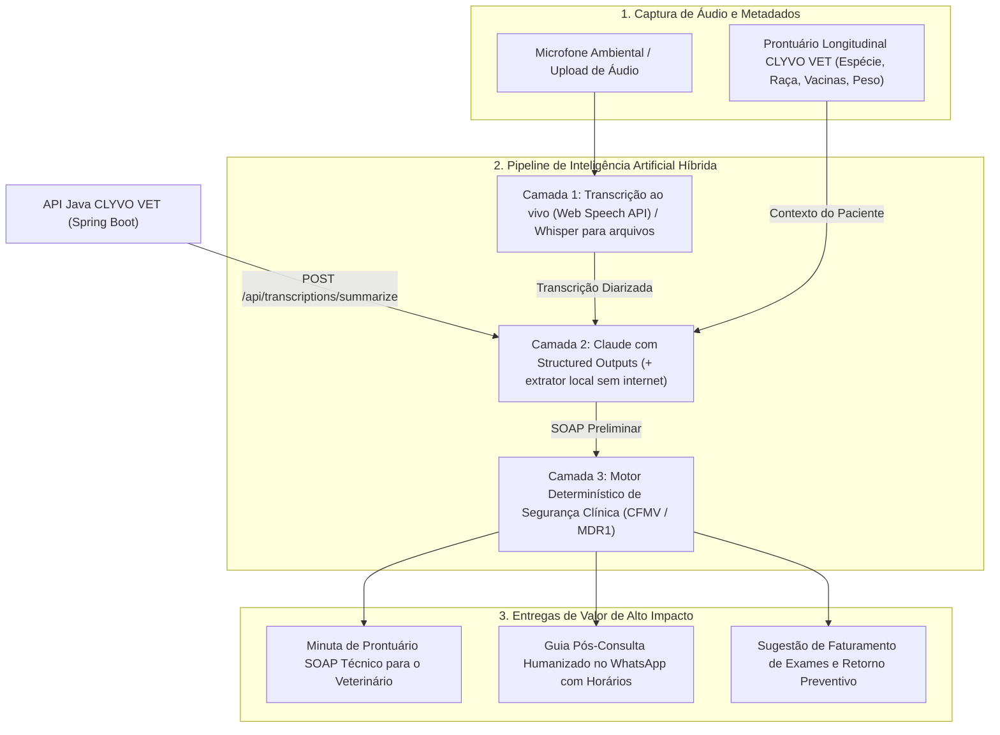

# 🐾 CLYVO VET — ClyvoScribe AI
> **Inteligência Clínica Ambiental e Apoio à Tomada de Decisão Veterinária**  
> *Transformando a escuta da consulta em prontuário SOAP estruturado, segurança medicamentosa e cuidado contínuo para o pet.*

[]()
[]()
[-orange.svg)]()
[-purple.svg)]()

---

##Integrantes

Maicon      RM561279
Gabriel F.  RM561551
Charlles    RM566482
Iago D.     RM565708

---

## 📌 Sumário Executivo e Problema de Negócio

Durante uma consulta veterinária típica, o médico-veterinário gasta entre **30% e 45% do tempo digitando anotações manuais** em prontuários eletrônicos engessados, dividindo a atenção enquanto contém animais estressados. Ao mesmo tempo, tutores angustiados esquecem mais de **50% das instruções verbais** minutos após sair da clínica, e procedimentos complementares citados verbalmente deixam de ser faturados ou agendados.

O **ClyvoScribe AI** resolve esse gargalo através de **escuta clínica ambiental consentida**:
1. **ASR Veterinário Especializado**: Captura o diálogo espontâneo entre veterinário e tutor, filtrando latidos, miados e ruídos de sala de exame.
2. **Estruturação Clínica SOAP Automática**: Organiza a consulta no padrão ouro (*Subjective, Objective, Assessment, Plan*) com extração de queixas, sinais vitais, hipóteses diagnósticas e prescrições.
3. **Motor Determinístico de Guardrails Clínicos (Symbolic AI)**: Cruza a prescrição com o perfil longitudinal do pet (raça, espécie, peso, histórico vacinal e comorbidades) para alertar riscos graves, como a mutação **MDR1** em raças pastoras ou toxicidade renal de AINEs em felinos.
4. **Impacto Duplo Imediato**:
   - **Para a Clínica**: Redução de até 70% no tempo administrativo, minuta pronta para assinatura digital (CRMV) e identificação de procedimentos faturáveis e vacinas em atraso.
   - **Para o Tutor**: Guia pós-consulta enviado diretamente para o WhatsApp com linguagem simples e cronograma de remédios com horários exatos e alarmes.

---

## 🏛️ Diagrama Arquitetural Fim a Fim



---

## 🚀 Como Executar o Projeto Localmente

O projeto foi arquitetado com **modo de execução autônomo** (Zero Dependências externas obrigatórias), permitindo que qualquer avaliador teste a aplicação imediatamente com o Python nativo do sistema operacional.

### 1. Clonar o Repositório
```bash
git clone https://github.com/MCGI-PW/IoT-Clyvo-Vet_M.git
cd IoT-Clyvo-Vet_M
```

### 2. Iniciar a Aplicação Web Interativa (1 Comando)
```bash
python3 run_server.py
```
> Acesse no seu navegador: **[http://localhost:8000](http://localhost:8000)**

*(Opcional: se preferir usar FastAPI/Uvicorn, basta executar `pip install -r requirements.txt` e rodar `uvicorn app.main:app --reload`)*.

### 3. Rodar os Testes Automatizados
```bash
python3 -m unittest discover -s tests -p "test_*.py"
```
*Saída esperada:*
```text
.............
----------------------------------------------------------------------
Ran 13 tests in 0.007s

OK
```

---

## 💻 Demonstração Interativa na Interface Web

Ao abrir a interface em `http://localhost:8000`, você terá acesso a uma experiência completa:
1. **Seleção de Pacientes**:
   - **Thor (Buldogue Francês)**: Apresenta queixa de otite e prurido. A IA dispara alerta de conformação braquicefálica e vacina antirrábica atrasada.
   - **Mel (Gata Siamês Geriátrica)**: Histórico de DRC. A IA emite **Alerta Vermelho Crítico** contra prescrição de anti-inflamatórios nefrotóxicos (Meloxicam).
   - **Bob (Border Collie)**: Apresenta claudicação. A IA emite alerta preventivo de sensibilidade genética no gene **MDR1** (Glicoproteína-P).
2. **Transcrição ao Vivo**: clique em **Iniciar Escuta** e fale a consulta. O texto aparece em tempo real (a frase em andamento surge como legenda em itálico) e pode ser corrigido antes de processar. Também é possível colar a transcrição de uma consulta gravada ou carregar com 1 clique um dos casos de exemplo.
3. **Abas Dinâmicas**:
   - **Prontuário SOAP**: Visão técnica estruturada completa pronta para assinatura digital do CRMV.
   - **Alertas Clínicos**: Cards com código de cores (Info, Alerta Amarelo e Perigo Vermelho).
   - **Visão do Tutor**: Mockup do WhatsApp do tutor com remédios, dosagens, horários calculados e sinais de perigo para monitorar em casa.
   - **Gestão da Clínica**: Tabela de procedimentos identificados na fala com cálculo de receita potencial adicionada.
   - **Transcrição ASR**: Texto integral da consulta com identificação dos interlocutores.

---

## 🤖 Como a IA Funciona (o que é real e o que é demonstração)

| Etapa | Como funciona | Onde está |
|---|---|---|
| **Transcrição ao vivo** | Reconhecimento de voz do navegador (Web Speech API, `pt-BR`), com legenda em tempo real. Funciona no Chrome e no Edge; nos demais, cole o texto. | `app/web/app.js` |
| **Consulta gravada (áudio)** | `POST /api/consultations/upload-audio` transcreve com o **Whisper** rodando local (pacote opcional `openai-whisper`). | `app/services/asr_service.py` |
| **Prontuário SOAP com IA generativa** | O **Claude** (Anthropic) recebe a transcrição e devolve o SOAP em **saída estruturada** (JSON Schema igual aos modelos Pydantic). O prompt proíbe inventar diagnóstico, remédio, dose ou prazo. | `app/services/claude_extractor.py` |
| **Plano B sem internet** | Sem chave de API, ou se o Claude falhar ou recusar, um extrator por regras classifica as frases reais da consulta (queixa, exame, diagnóstico, prescrição com dose, frequência e duração, orientações, sinais de alerta). | `app/services/local_extractor.py` |
| **Casos de exemplo** | Thor, Mel e Bob têm um protocolo pronto (gabarito) para a demonstração offline. Com o Claude ligado, eles também passam pela IA. | `app/services/clinical_nlp.py` |
| **Segurança clínica** | A IA simbólica cruza o SOAP com o perfil do pet (MDR1, DRC + AINE, braquicefálicos, vacinas). | `app/services/decision_support.py` |

A interface mostra qual IA gerou cada prontuário: *IA: Claude*, *Extração local por regras* ou *Protocolo de demonstração*.

**Ativar o Claude** (opcional):
```bash
pip install anthropic
export ANTHROPIC_API_KEY="sua_chave"
export CLYVO_IA_MODEL="claude-opus-5-5"   # opcional, este já é o padrão
python3 run_server.py
```

**LGPD:** para a IA vão apenas a transcrição e o nome, a espécie e a raça do pet. Nome e telefone do tutor ficam de fora.

### Integração com a API Java da CLYVO VET

O ClyvoScribe é o serviço de IA da plataforma. A API Java ([API-Clyvo-M_Vet](https://github.com/MCGI-PW/API-Clyvo-M_Vet)) envia a transcrição da teleconsulta para cá e recebe o resumo pronto para pré-preencher o prontuário:

```bash
curl -X POST http://localhost:8000/api/transcriptions/summarize \
  -H "Content-Type: application/json" \
  -d '{"transcript": "Parece ser uma otite. Vou prescrever 3 gotas duas vezes ao dia por 7 dias. Retorno em 10 dias.", "contexto_paciente": "Thor (Buldogue Francês)"}'
```

Resposta: `diagnostico`, `prescricao`, `orientacoes`, `resumo_tutor`, `sinais_alerta`, `alertas_clinicos` e `fonte` (qual IA gerou). No Java, basta subir com `CLYVOSCRIBE_URL=http://localhost:8000`; se o ClyvoScribe estiver fora do ar, a API Java usa o assistente local dela e a consulta não trava.

---

## 📂 Estrutura do Repositório

```text
clyvo-vet-ai/
├── README.md                           # Este documento com guia completo do projeto
├── run_server.py                       # Servidor universal de inicialização imediata
├── requirements.txt                    # Dependências opcionais para ambiente FastAPI completo
├── .env.example                        # Variáveis de ambiente configuráveis
├── docs/
│   ├── AI_SPECIFICATION.md             # Especificação formal da IA, dor de negócio e justificativa
│   ├── ARCHITECTURE.md                 # Arquitetura de integração, fluxo de dados e diagramas Mermaid
│   ├── DATA_DICTIONARY.md              # Dicionário de dados, schemas Pydantic/JSON e ciclo de vida
│   ├── PITCH_SCRIPT_5MIN.md            # Roteiro teleprompter detalhado para o vídeo de 5 minutos
│   └── SLIDES_OUTLINE.md               # Roteiro slide-a-slide para apoio visual da apresentação
├── app/
│   ├── config.py                       # Configurações globais e caminhos
│   ├── main.py                         # Endpoints REST da API FastAPI
│   ├── models/
│   │   ├── base.py                     # Compatibilidade Pydantic / Standard Library
│   │   ├── pet.py                      # Modelos do perfil biométrico e histórico do paciente
│   │   └── consultation.py             # Modelos de SOAP, alertas, prescrição e faturamento
│   ├── services/
│   │   ├── asr_service.py              # Transcrição de áudio gravado (Whisper) e casos de exemplo
│   │   ├── clinical_nlp.py             # Orquestra a extração SOAP: Claude, protocolos demo ou extrator local
│   │   ├── claude_extractor.py         # Claude (Anthropic) com saída estruturada em JSON Schema
│   │   ├── local_extractor.py          # Extrator por regras das frases reais da consulta (sem internet)
│   │   ├── decision_support.py         # Motor determinístico de apoio à decisão (MDR1, DRC, Raças)
│   │   ├── tutor_care_generator.py     # Gerador de linguagem empática e tabela de oportunidades
│   │   └── pipeline.py                 # Orquestrador central fim a fim
│   └── web/                            # Interface web moderna e responsiva
│       ├── index.html                  # Dashboard interativo de atendimento
│       ├── style.css                   # Estilos visuais e responsividade
│       └── app.js                      # Lógica de interação, áudio e integração com a API
├── samples/
│   ├── audio_transcripts.json          # Amostras realistas de consultas veterinárias em português
│   └── pet_profiles.json               # Perfis médicos de pets para demonstração
├── tests/
│   ├── test_clinical_pipeline.py       # Testes de integração do pipeline de IA
│   ├── test_decision_support.py        # Testes de unidade das regras clínicas determinísticas
│   └── test_transcricao_real.py        # Extrator local, Claude (cliente simulado), fallback e resumo para integração
└── scripts/
    └── package_submission.sh           # Script utilitário para gerar o .zip final da entrega
```

