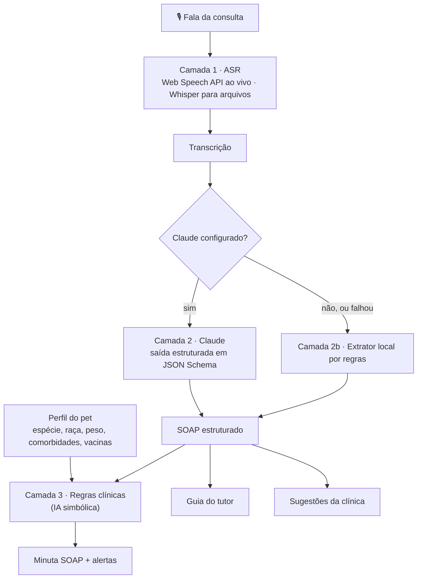

# Especificação do Componente de IA: AuroraScribe AI (Aurora Pet)

Este documento nasceu na Sprint 3, quando definimos o problema, os dados e a abordagem de IA, e foi atualizado na Sprint 4 com o que foi implementado. Cada item mostra onde está no código. O que ainda não existe aparece como **planejado**.

---

## 1. Problema de negócio

A consulta é o momento em que se concentram a conversa com o tutor, o exame, o diagnóstico e a orientação. Hoje três problemas aparecem juntos:

1. **Veterinário dividido entre o animal e o teclado.** O prontuário é digitado durante ou depois do atendimento. A atenção sai do paciente, e o registro fica telegráfico e incompleto, o que enfraquece o histórico do pet.
2. **Tutor que esquece as orientações.** Dose, horário, duração e sinais de alerta são ditos em voz alta, num momento de ansiedade, e se perdem quando o tutor sai da clínica.
3. **Riscos que dependem da memória.** Contraindicações por raça (como a mutação MDR1 das raças pastoras) ou por doença crônica (anti-inflamatório em gato com doença renal) dependem de o profissional lembrar na hora. Exames e retornos citados na conversa também deixam de ser agendados.

O problema escolhido para a IA fica dentro da **jornada contínua de cuidado do pet**: transformar a conversa da consulta em registro estruturado, segurança clínica e orientação clara para o tutor.

---

## 2. Valor para tutor, clínica e pet

| Ator | Dor | O que a IA entrega | Status |
|---|---|---|---|
| **Veterinário** | Digitação, prontuário incompleto | Minuta SOAP gerada a partir da fala, para revisar e aprovar | ✅ implementado |
| **Pet** | Remédio perigoso para a raça ou a doença | Alertas automáticos de contraindicação e gravidade | ✅ implementado |
| **Tutor** | Esquece dose, horário e sinais de alerta | Resumo em linguagem simples, com horários e sinais de alerta | ✅ na tela · envio por WhatsApp **planejado** |
| **Clínica** | Exames e retornos citados que não viram agenda | Sugestão de exames, retorno, vacinas e valor estimado | ✅ implementado |

---

## 3. Personalização, priorização e recomendação

### 3.1 Personalização pelo perfil do pet
O motor de regras cruza o que foi dito com o cadastro do animal (`app/services/decision_support.py`):

| Regra | Dado do pet | Exemplo | Nível |
|---|---|---|---|
| Mutação MDR1 | Raça pastora (Border Collie, Collie, Pastor Australiano, Pastor de Shetland…) | Aviso para a raça; se a conversa citar ivermectina, loperamida, moxidectina ou quimioterápicos, alerta crítico | 🟡 / 🔴 |
| Felino renal | Espécie felina + comorbidade renal (ou menção a "renal", ou urgência) | Meloxicam, cetoprofeno, carprofeno, gentamicina… citados viram contraindicação absoluta | 🔴 |
| Braquicefálico | Raça (Buldogue Francês, Pug, Shih Tzu…) | Cuidado com contenção, estresse e temperatura | ℹ️ |
| Vacina atrasada | Histórico vacinal com status `atrasada` | Sugere o reforço depois da cura clínica | 🟡 |

Nos protocolos de demonstração, a dose também é calculada pelo **peso** (mg/kg).

### 3.2 Priorização pela gravidade
Cada consulta recebe um nível: `rotina_estavel`, `monitoramento_moderado` ou `urgencia_imediata`. O Claude classifica pelo contexto; o extrator local marca urgência quando aparecem termos como "internação", "emergência" ou "risco de vida". Urgência gera um alerta vermelho de gravidade imediata.

### 3.3 Recomendação de serviços e cuidado contínuo
`app/services/tutor_care_generator.py` transforma o plano em ações: exames citados (citologia, ultrassom, bioquímico, radiografia), internação, retorno em N dias e vacinas atrasadas viram itens sugeridos, com valor estimado. A clínica recebe também sugestões de acompanhamento (mensagem ao tutor em 48 horas, reserva do retorno, lembrete de recompra).

---

## 4. Abordagem de IA e justificativa

Escolhemos uma **arquitetura híbrida**: IA generativa (LLM) para entender a linguagem natural da consulta, mais regras determinísticas para o que exige rigor.

### 4.1 Camada 1: reconhecimento de fala
- **Escolha:** Web Speech API do navegador (`pt-BR`, resultados parciais em tempo real) para a consulta ao vivo; Whisper rodando local (`openai-whisper`, opcional) para áudios gravados.
- **Por quê:** a Web Speech API não exige instalar nada e mostra a legenda enquanto se fala, o que encaixa na teleconsulta. O Whisper roda sem enviar o áudio para fora e cobre o caso da consulta gravada.
- **Limites:** a Web Speech API só funciona no Chrome e no Edge, em HTTPS ou `localhost`. A separação automática de locutores ainda é **planejada**; hoje os rótulos "Tutor:" e "Veterinário:" vêm do texto.

### 4.2 Camada 2: LLM com saída estruturada
- **Escolha:** Claude, da Anthropic (`claude-opus-5-5`, SDK oficial `anthropic`), com `output_config` em **JSON Schema** espelhando o modelo `SOAPRecord` (`app/services/claude_extractor.py`).
- **Por quê:** um LLM distingue, numa conversa solta, o que é queixa do tutor ("ele vomitou duas vezes") e o que é achado do exame ("temperatura 39,2"). A saída estruturada garante que o backend receba sempre o mesmo formato, com tipos certos (frequência em horas e duração em dias como inteiros).
- **Controles:** o prompt proíbe inventar diagnóstico, remédio, dose, exame ou prazo; campo não falado fica vazio. Recusa (`stop_reason = refusal`) e resposta truncada (`max_tokens`) são tratadas como falha e caem no plano B.

### 4.3 Camada 2b: extrator local (plano B)
- **Escolha:** classificação de cada frase por palavras-chave sem acento (`app/services/local_extractor.py`), com leitura de números falados ("duas vezes ao dia" = a cada 12h, "durante duas semanas" = 14 dias) e do nome do remédio depois do verbo ("vou prescrever…", "vou passar…").
- **Por quê:** a consulta não pode parar por falta de internet, de chave ou por falha da API externa. E o extrator só usa frases que existem na transcrição.

### 4.4 Camada 3: regras clínicas determinísticas
- **Escolha:** motor de regras em Python (`app/services/decision_support.py`).
- **Por quê:** não se deixa contraindicação grave a cargo de probabilidade. A mesma entrada gera sempre o mesmo alerta, e cada regra pode ser lida e auditada.

---

## 5. Dados necessários

| Dado | Origem | Estrutura | Uso |
|---|---|---|---|
| Transcrição da consulta | Microfone, áudio gravado ou texto | Texto livre, com rótulos de locutor opcionais | Entrada do SOAP |
| Perfil do pet | Cadastro da Aurora Pet | `PetHealthProfile`: espécie, raça, sexo, idade, peso, escore corporal | Regras de raça e espécie; dose por kg |
| Histórico clínico | Prontuário | `comorbidades_cronicas`, `alergias_conhecidas`, `medicamentos_continuos` | Contraindicações |
| Vacinas | Cartão de vacinas | `historico_vacinal`: vacina, data, status | Alerta e sugestão de reforço |
| Consultas anteriores | Oracle (API Java) | Tabelas `consulta`, `prontuario` e `transcricao_consulta` | Histórico e rastreabilidade da IA |
| Comportamento e rotina | Falado na consulta | Campo `comportamento_e_rotina` do SOAP | Contexto da queixa |

Na integração, a API Java envia hoje a transcrição e "Nome (Raça)". O envio de comorbidades e vacinas pela integração é **planejado**; na interface de demonstração, o perfil completo vem de `samples/pet_profiles.json`.

Detalhes e schemas em [`DATA_DICTIONARY.md`](DATA_DICTIONARY.md).

---

## 6. Governança, ética e LGPD

1. **Consentimento:** o microfone só liga com o clique do veterinário, e o navegador pede permissão ao usuário.
2. **Mínimo necessário:** para a IA vão a transcrição e nome, espécie e raça do pet. Dados do tutor (nome, CPF, telefone) não são enviados. A remoção automática de nomes ditos dentro da conversa é **planejada**.
3. **Humano no controle:** o resultado é uma minuta. Na Aurora Pet, o texto só entra no prontuário quando o veterinário revisa e conclui o atendimento.
4. **Rastreabilidade:** cada resumo guarda qual IA o gerou (`CLAUDE:<modelo>`, `LOCAL:extracao`, `LOCAL:protocolo-demo`, e na API Java `AURORASCRIBE` ou `LOCAL`).
