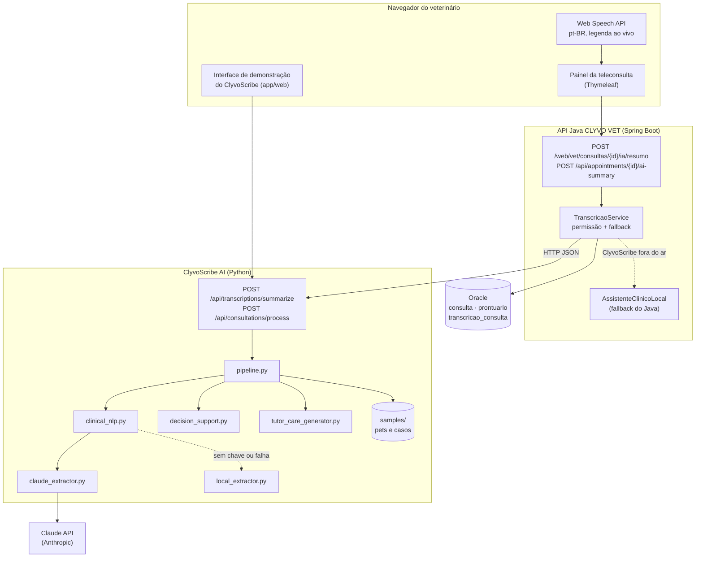
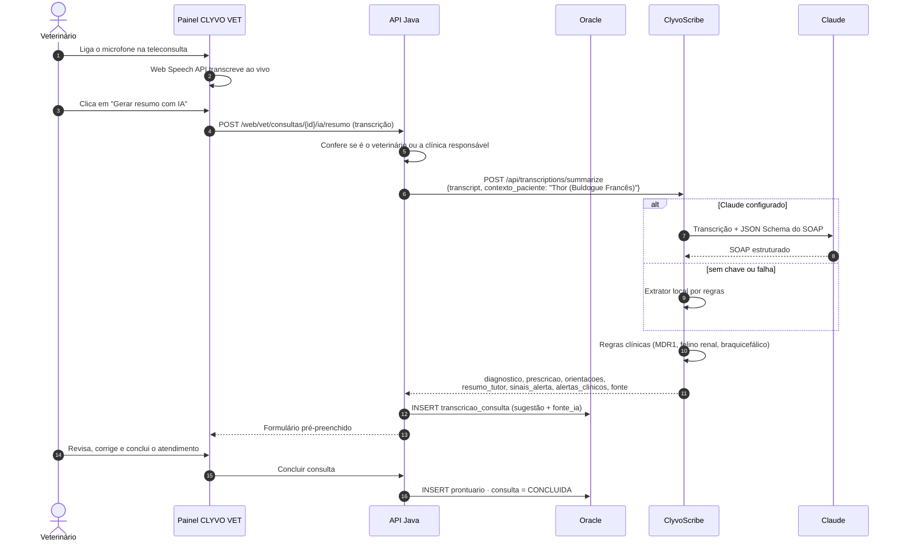

# Arquitetura: ClyvoScribe AI na plataforma CLYVO VET

## 1. Visão geral

O ClyvoScribe é um **serviço de IA em Python**, separado da aplicação principal. A CLYVO VET (API Java com Spring Boot, telas em Thymeleaf e banco Oracle) atende tutores, veterinários e clínicas, e chama o ClyvoScribe por **HTTP/JSON** quando o veterinário pede o resumo da consulta.

| Componente | Responsabilidade | Tecnologia | Repositório |
|---|---|---|---|
| Painel do veterinário | Teleconsulta, microfone e revisão do resumo | Thymeleaf + JavaScript (Web Speech API) | API-Clyvo-M_Vet |
| API Java (`TranscricaoService`) | Permissão, chamada à IA, gravação no banco, fallback | Java 21, Spring Boot | API-Clyvo-M_Vet |
| Banco | Consultas, prontuários e sugestões da IA | Oracle, migrations Flyway (V1 a V7) | API-Clyvo-M_Vet |
| **ClyvoScribe AI** | Transcrição de arquivos, SOAP, regras clínicas, guia do tutor | Python 3.9+ (servidor nativo ou FastAPI) | **este repositório** |
| IA generativa | Extração SOAP com saída estruturada | Claude (Anthropic) | API externa |

Dentro do ClyvoScribe, as camadas ficam separadas:

| Camada | Arquivos |
|---|---|
| Entrada (HTTP) | `run_server.py` (sem dependências) · `app/main.py` (FastAPI, mesmas rotas) |
| Orquestração | `app/services/pipeline.py` |
| IA | `asr_service.py` (fala) · `clinical_nlp.py` (escolhe a IA) · `claude_extractor.py` · `local_extractor.py` · `decision_support.py` · `tutor_care_generator.py` |
| Modelos | `app/models/` (`PetHealthProfile`, `SOAPRecord`, `ClinicalAlert`, `TutorCareGuide`, `ClinicRecommendation`) |
| Interface de demonstração | `app/web/` |

---

## 2. Componentes e comunicação

---

## 3. Fluxo de dados fim a fim

Se o ClyvoScribe não responder (timeout de 90 s, erro HTTP ou rede), a API Java usa o `AssistenteClinicoLocal` e grava a fonte `LOCAL`.

---

## 4. Endpoints do ClyvoScribe

| Método e rota | Uso | Servidor nativo | FastAPI |
|---|---|:---:|:---:|
| `GET /api/health` | Saúde do serviço | ✅ | ✅ |
| `GET /api/pets` · `GET /api/pets/{id}` | Perfis de demonstração | ✅ | ✅ |
| `GET /api/cases` | Casos de exemplo | ✅ | ✅ |
| `POST /api/consultations/process` | Pipeline completo (SOAP, alertas, guia do tutor, clínica) para a interface de demonstração | ✅ | ✅ |
| `POST /api/transcriptions/summarize` | **Integração com a API Java** | ✅ | ✅ |
| `POST /api/consultations/upload-audio` | Áudio gravado → Whisper → pipeline | — | ✅ |
| `POST /api/consultations/finalize` | Aprovação da minuta na demonstração (não grava nada) | ✅ | ✅ |

Contratos em [`DATA_DICTIONARY.md`](DATA_DICTIONARY.md).

---

## 5. Resiliência

| Falha | O que acontece |
|---|---|
| Sem `ANTHROPIC_API_KEY` ou sem o pacote `anthropic` | O ClyvoScribe usa o extrator local; `fonte = LOCAL:extracao` |
| Claude falha, recusa ou trunca a resposta | Log de aviso e extrator local |
| ClyvoScribe fora do ar ou lento | A API Java usa o assistente local dela; `fonte_ia = LOCAL` |
| Navegador sem Web Speech API, ou fora de HTTPS | A interface avisa, e o veterinário cola a transcrição |
| Whisper não instalado | `upload-audio` responde com a instrução de instalação |

---

## 6. Segurança e LGPD

- **Dados mínimos para a IA:** transcrição, nome, espécie e raça do pet. O contexto montado pela API Java (`contextoDoPaciente`) não inclui dados do tutor.
- **Autorização:** só o veterinário ou a clínica responsáveis pela consulta geram ou leem o resumo (checado na API Java).
- **Transporte:** a aplicação online da CLYVO VET usa HTTPS (certificado Let's Encrypt). A chave do Claude fica em variável de ambiente, nunca no código.
- **Humano no controle:** a sugestão fica em `transcricao_consulta`; o `prontuario` só é criado quando o veterinário conclui o atendimento.

---

## 7. Implantação

- **Hoje:** o ClyvoScribe roda localmente (`python3 run_server.py`, porta 8000), e a API Java aponta para ele com `CLYVOSCRIBE_URL`. A versão online da CLYVO VET (Azure Container Instances) roda sem `CLYVOSCRIBE_URL`, com o assistente local do Java.
- **Planejado:** publicar o ClyvoScribe como mais um container no mesmo grupo do Azure, com `CLYVOSCRIBE_URL=http://localhost:8000`.
